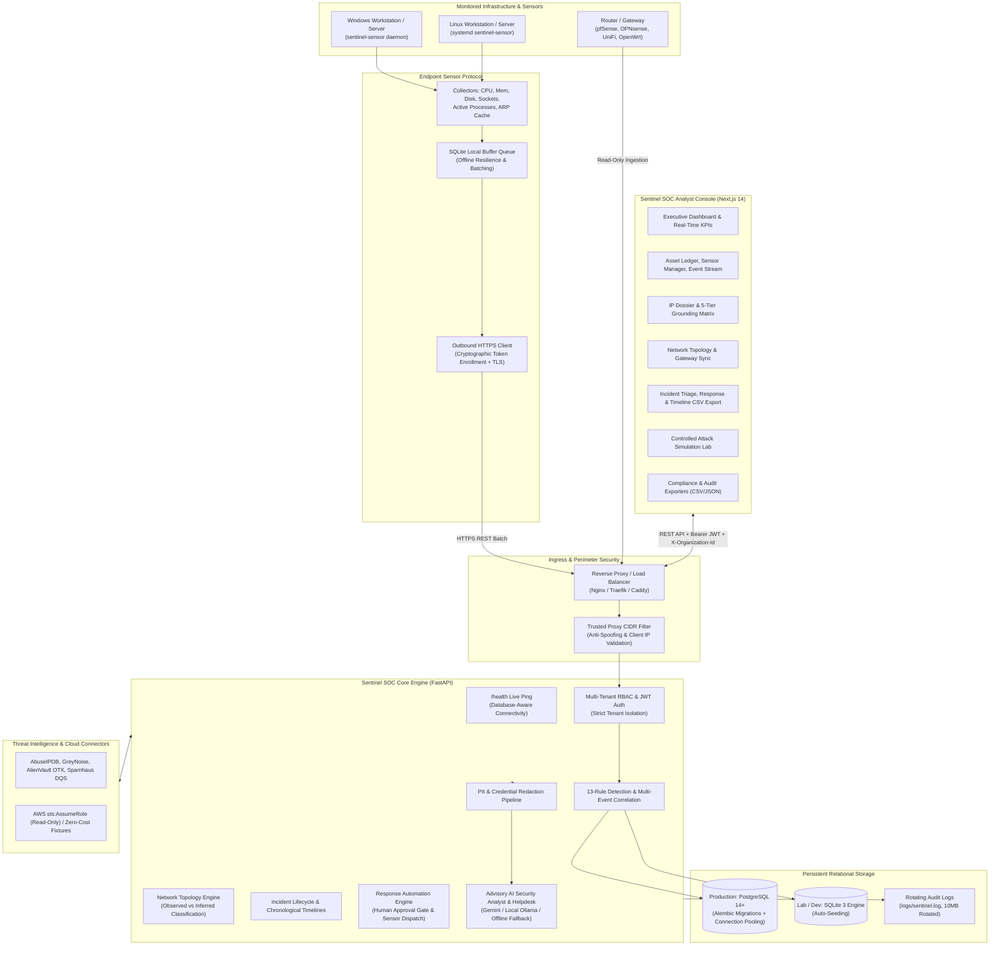

# SENTINEL SOC — Enterprise Security Operations Center

> **Monitor. Detect. Investigate. Protect.**  
> *A modern, multi-tenant, AI-assisted Security Operations Center platform engineered for cybersecurity analysts, security engineers, and defensive lab environments.*

[](https://fastapi.tiangolo.com)
[](https://nextjs.org)
[](https://www.postgresql.org)
[](https://alembic.sqlalchemy.org)
[](https://tailwindcss.com)
[](https://playwright.dev)
[](https://docs.pytest.org)
[](https://opensource.org/licenses/MIT)

---

## 🛡️ Executive Summary

**SENTINEL SOC** is a full-featured, centralized security monitoring and incident response platform. Built from the ground up with a privacy-first, zero-cost architecture, it bridges endpoint observability, network topology discovery, threat intelligence enrichment, multi-event correlation, AWS cloud posture assessment, and human-in-the-loop advisory AI assistance.

Sentinel SOC operates seamlessly across **native development/lab mode** (zero-configuration SQLite) and **production containerized deployment** (PostgreSQL 14+, Alembic migrations, connection pooling, trusted reverse proxy filtering, and rotating audit logs).

---

## 📐 Architecture Overview



---

## 🌟 Comprehensive 18-Feature Matrix

| # | Feature / Module | Route | Capabilities & Verification |
| :---: | :--- | :--- | :--- |
| **1** | **Executive Dashboard** | `/dashboard` | Real telemetry KPIs, 24h event trends, severity breakdown, integration status, and genuine vs. simulated segmented counters. |
| **2** | **Asset Inventory** | `/assets` | Windows and Linux host discovery, hardware telemetry (CPU, RAM, disk), active socket counts, and health tracking. |
| **3** | **Sensor Management** | `/sensors` | Single-use cryptographic enrollment tokens (48h expiry), heartbeat monitor, credential revocation, and SHA-256 API keys. |
| **4** | **Security Events Stream** | `/events` | Real-time filterable event ledger, raw JSON inspection, and strict `GENUINE` vs `SIMULATED` event badges. |
| **5** | **IP Intelligence Center** | `/ip-intel` | Dual IPv4/IPv6 classification, ASN & GeoIP lookup, 5-tier evidence grounding matrix, analyst dossiers (`Benign`/`Suspicious`/`Malicious`), and chronological timelines. |
| **6** | **Multi-Threat Intel Adapters** | `/ip-intel` | Native adapters for AbuseIPDB, GreyNoise Community, AlienVault OTX, and Spamhaus DQS with 24h TTL cache and rate-limit guardrails. |
| **7** | **Network Intelligence** | `/network` | Subnet & sensor coverage gauges, interactive topology graph strictly classifying links as `OBSERVED` (ARP/sockets) vs `INFERRED` (CIDRs). |
| **8** | **Router & Gateway Integrations**| `/network` | Integration templates for pfSense CE, OPNsense, UniFi Dream Machine, and OpenWrt with read-only credential handling. |
| **9** | **Detection Center & Engine** | `/detections` | 13 pre-tuned detection rules, parameter threshold and time window tuning modal, and MITRE ATT&CK technique tags. |
| **10** | **Multi-Event Correlation** | `/detections` | Multi-asset credential stuffing and brute-force followed by outbound C2 beaconing attack chains with threshold parameters. |
| **11** | **Incident Management & Triage** | `/incidents` | Master-detail incident triage, severity escalation, containment workflows, analyst notes, and 1-click CSV timeline downloads. |
| **12** | **Response Automation & Gates** | `/incidents` | Human-in-the-loop approval gate, tamper-evident audit logging, and endpoint sensor command dispatching (host isolation, kill process). |
| **13** | **Attack Simulation Lab** | `/simulation` | Controlled attack generator (SSH brute force, port scan, C2 beaconing) with simulation labeling and 1-click safe state reset. |
| **14** | **AWS Cloud Security Expansion** | `/aws-security` | Cross-account `sts:AssumeRole` with unique per-tenant External IDs, least-privilege IAM policy generator, and 1-click zero-cost fixtures. |
| **15** | **Advisory AI Security Analyst** | `/ai-analyst` | Grounded 5-part advisory briefing with MITRE ATT&CK mapping via Google Gemini, local Ollama, or deterministic fallback. |
| **16** | **Sentinel AI Helpdesk** | `/ai-helpdesk` | Conversational RAG knowledge assistant indexed on SOC markdown documentation with automatic regex credential scrubbing. |
| **17** | **Reports & Compliance Exports**| `/reports` | Multi-format CSV and JSON exports across incidents, telemetry events, threat intel indicators, network inventory, and AWS findings. |
| **18** | **Administration & Audit Ledger** | `/admin` | Real-time database health check, AI quota gauge, tenant management, and immutable system audit log ledger. |

---

## 💻 Technology Stack

| Layer | Technologies | Key Highlights |
| :--- | :--- | :--- |
| **Backend Core** | Python 3.11+, FastAPI, Pydantic v2 | High-performance async REST API, strict typing, auto-generated OpenAPI / Swagger specs. |
| **Database & ORM** | PostgreSQL 14+, SQLite, SQLAlchemy 2.0, Alembic | Dialect-agnostic ORM, automatic connection pooling, versioned migration revisions. |
| **Security & Auth** | OAuth2 Password Bearer, PyJWT, Passlib (Bcrypt), Cryptography | Multi-tenant isolation (`organization_id`), SHA-256 sensor key hashing, single-use tokens. |
| **Reverse Proxy Security** | Custom Trusted Proxy Middleware, Uvicorn Proxy Headers | Strict CIDR validation (`TRUSTED_PROXIES`), spoofing prevention, client IP extraction. |
| **Frontend Framework** | Next.js 14 (App Router), TypeScript, React 18 | Server-side static generation (22 routes), client hydration, modular component design. |
| **Styling & UI** | Tailwind CSS 3.4, Lucide React Icons | Responsive dark-mode SOC theme, high-contrast security severity badges, accessible tables. |
| **Testing & E2E** | Pytest, Playwright Chromium, ESLint, TSC | 25 backend unit/integration tests, 15 frontend end-to-end tests, 0 lint/type errors. |
| **Containerization** | Docker, Docker Compose, Multi-stage builds | Production Dockerfiles with integrated healthchecks and unprivileged service execution. |

---

## ⚡ Quick Start

For detailed instructions, refer to the [Installation Manual](docs/INSTALLATION.md).

### Option 1: Native Workstation / Lab Mode (Zero Setup)

```bash
# 1. Clone repository
git clone https://github.com/your-org/sentinel-soc.git
cd sentinel-soc

# 2. Configure environment
# Windows:
Copy-Item .env.example .env
# Linux / macOS:
cp .env.example .env

# 3. Setup Python virtual environment & backend
python -m venv .venv
# Activate:
# Windows: .\.venv\Scripts\Activate.ps1
# Linux:   source .venv/bin/activate
pip install -r backend/requirements.txt
python -m backend.app.db.seed
python -m uvicorn backend.app.main:app --host 127.0.0.1 --port 8000 --reload

# 4. In a separate terminal, launch the frontend
cd frontend
npm install
npm run dev
```

- **Web Console:** [http://localhost:3000](http://localhost:3000)
- **API Swagger Docs:** [http://localhost:8000/docs](http://localhost:8000/docs)
- **Healthcheck:** [http://localhost:8000/health](http://localhost:8000/health)
- **Local Development Admin Account:** `admin@sentinelsoc.com` (Default dev password: `SentinelAdmin123!` — mandatory rotation enforced on first login; in production, set `INITIAL_ADMIN_PASSWORD`)

---

### Option 2: Docker Compose Production Deployment

```bash
# Launch containerized PostgreSQL, backend, and frontend
docker compose up -d --build

# Verify container health
docker compose ps
```

---

## 🔒 Security Principles & Boundaries

1. **Strict Multi-Tenancy:** All security telemetry, assets, sensors, incidents, detections, and audit logs are partitioned by `organization_id`. Tenant cross-talk is prevented at the database query layer.
2. **Reverse Proxy Trust Filtering:** Header values (`X-Forwarded-For`, `X-Real-IP`) are strictly disregarded unless the connection originates from an explicitly trusted IP/CIDR defined in `TRUSTED_PROXIES`.
3. **Truth in Telemetry:** Genuine endpoint telemetry and simulated attack events are strictly segregated using the `is_simulated` boolean attribute. Verification scripts and laboratory tests never pollute production data.
4. **Human-in-the-Loop Response Automation:** High-impact remediation actions (such as host network isolation or process termination) require explicit operator review and approval via the tamper-evident response queue.
5. **Privacy & Redaction Pipeline:** All external AI requests pass through an automated credential scrubbing pipeline that strips API tokens, SSH keys, passwords, and private IP addresses prior to transmission.
6. **Zero Paid Dependencies:** All platform functionality operates cleanly using open-source engines and free-tier community API tiers.

---

## 🧪 Verification & Test Suite Results

| Test Category | Framework / Tool | Scope | Result | Execution Time |
| :--- | :--- | :--- | :---: | :---: |
| **Backend Unit & Integration** | Pytest 9.2 (`python -m pytest backend/tests`) | 25 tests covering auth, correlation, AI, threat intel, tenancy, sensors, health & trusted proxies | **25 / 25 PASSED** | ~12.2s |
| **Frontend End-to-End** | Playwright Chromium (`npx playwright test`) | 15 E2E workflows covering all 15 routes, navigation, forms, modals, exports, and error states | **15 / 15 PASSED** | ~9.8s |
| **TypeScript Type Checking** | TypeScript Compiler (`npx tsc --noEmit`) | Strict type validation across all 22 Next.js App Router routes and components | **0 Errors** | ~4.1s |
| **Frontend Code Quality** | Next.js ESLint (`npm run lint`) | ESLint standard rules and React Hooks compliance | **0 Errors** | ~5.2s |
| **Sensor Pipeline Verification** | `verify_sensor_pipeline.py` | 12-step live Windows endpoint collection, token enrollment, 401 rejection, detection, incident inheritance | **100% SUCCESS** | ~8.0s |
| **Response Automation Lifecycle**| `verify_response_automation.py` | 9-step approval gate, queue dispatch, heartbeat polling, dry-run diagnostic probe, acknowledgement | **100% SUCCESS** | ~3.1s |
| **PostgreSQL 18 Migration** | Alembic Head (`alembic upgrade head`) | Schema creation across 20+ relational tables, foreign keys, and indexes on live PostgreSQL | **100% SUCCESS** | ~1.4s |

---

## 📚 Documentation Directory

- 📖 [Installation Guide](docs/INSTALLATION.md) — Comprehensive installation and environment setup.
- 🚀 [Deployment Guide](docs/DEPLOYMENT.md) — Docker Compose, PostgreSQL production, and Nginx reverse proxy.
- 📐 [Architecture Reference](docs/ARCHITECTURE.md) — Detailed system architecture, data models, and protocols.
- 🔐 [Security & Threat Model](docs/SECURITY.md) — RBAC, trusted proxies, secrets management, and safety controls.
- 🧪 [Testing & Verification](docs/TESTING.md) — Test procedures, Playwright test definitions, and CI guidelines.
- 📊 [Feature Status & Ledger](docs/FEATURE_STATUS.md) — Detailed audit log of all 18 completed features.
- 🌐 [API Reference](docs/API.md) — Complete REST API endpoint documentation.
- 📡 [Sensor Protocol Specification](docs/SENSOR_PROTOCOL.md) — Protocol specifications for custom sensor agents.

---

## 📄 License & Attribution

Distributed under the **MIT License**. Engineered for defensive cybersecurity teams, security operations training, and portfolio demonstration.
