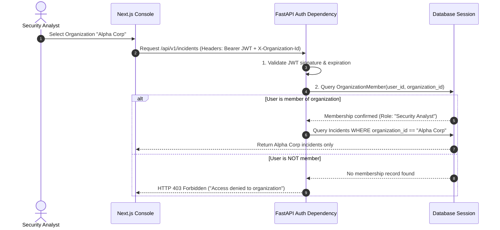

# SENTINEL SOC — System Architecture Specification

## 1. Architectural Philosophy

Sentinel SOC is engineered according to core principles:
1. **Modular Monolith over Microservice Bloat:** High cohesion, low friction, lightning-fast inter-module communication, and minimal deployment overhead.
2. **Zero Mandatory Paid Subscriptions:** All platform functions execute autonomously using open-source utilities and local or genuinely free-tier endpoints.
3. **Defense-in-Depth Multi-Tenancy:** Hard isolation of all organizational data enforced at the ORM query level and API dependency gatekeeper.
4. **Separation of Real vs. Synthetic Signals:** Ground-truth security telemetry is never contaminated with simulated attack laboratory data, imported threat intelligence, or ungrounded AI inferences.
5. **Advisory AI Boundaries:** AI serves as a force multiplier for the human analyst. Destructive response actions (e.g., host isolation, firewall rules, sensor revocation) require explicit analyst approval.
6. **Topology Grounding:** Network links are strictly categorized as `OBSERVED` (hardware/ARP/socket verified) or `INFERRED` (heuristic/CIDR routing).

---

## 2. System Architecture Diagram

```mermaid
graph TB
    subgraph DataSources["Data Collection Boundaries"]
        WS["Windows Workstation / Server"]
        LX["Linux Workstation / Server"]
        RT["Router / Gateway (pfSense, OPNsense, UniFi, OpenWrt)"]
        PUB["Sentinel Web Ingress (Reverse Proxy)"]
        AWS["AWS AssumeRole Read-Only API / Offline Fixtures"]
        LAB["Controlled Attack Simulator"]
    end

    subgraph SensorLayer["Local Endpoint Sensor"]
        SC["System & Metric Collector"]
        NC["Network & Sockets Collector"]
        AC["Subnet ARP Discovery"]
        LC["Security Log Collector"]
        BUF[("Local SQLite Queue")]
        CLI["Outbound TLS Client"]
    end

    subgraph CoreEngine["Sentinel Backend Engine (FastAPI)"]
        API["REST API Router (FastAPI)"]
        AUTH["Auth & Multi-Tenant Dependency"]
        ING["Telemetry Ingestion Pipe"]
        DET["13-Rule Deterministic Engine"]
        CORR["Multi-Event Correlation Engine"]
        NET_ENG["Network Coverage & Topology Engine"]
        INC["Incident & Timeline Manager"]
        REP["Compliance & Export Generator"]
        PII["Sanitization & Redaction Layer"]
        RAG["Documentation RAG Engine"]
    end

    subgraph ExternalIntelligence["Intelligence & Advisory"]
        AI_GEMINI["Google Gemini API (Free Tier)"]
        AI_LOCAL["Local Model (Ollama / LocalAI)"]
        AI_FALL["Deterministic Fallback Engine"]
        TI_ABUSE["AbuseIPDB Free API"]
        TI_GREY["GreyNoise Community API"]
        TI_OTX["AlienVault OTX API"]
        TI_SPAM["Spamhaus DQS / DNSBL"]
        TI_CACHE[("Threat Intel Cache (TTL 24h)")]
    end

    subgraph Persistence["Storage & Caching"]
        DB[("PostgreSQL 16 / SQLite Engine")]
        REDIS[("Redis 7 / Memory Cache")]
    end

    subgraph UserInterface["Sentinel Console (Next.js 14)"]
        UI["Modern Dark SOC Dashboard (Tailwind + Lucide)"]
        TOPOLOGY["Observed vs Inferred Network Topology"]
        DOSSIER["IP Dossier & 5-Tier Grounding View"]
        TIMELINE["Incident Timeline & Case Ledger"]
        EXPORTS["CSV & JSON Compliance Exporters"]
        MODAL["Explain This Error RAG Modal"]
    end

    WS --> SC & NC & AC & LC
    LX --> SC & NC & AC & LC
    SC & NC & AC & LC --> BUF
    BUF --> CLI
    CLI -->|HTTPS POST /telemetry| ING

    RT -->|REST / SSH Read-Only Sync| API
    PUB -->|X-Forwarded-For + Remote Addr| API
    AWS --> API
    LAB --> API

    API --> AUTH
    AUTH --> ING
    ING --> DET
    DET --> CORR
    CORR --> INC
    INC --> DB
    ING --> DB
    API --> NET_ENG
    NET_ENG --> DB

    UI <--> API
    API --> PII
    PII --> AI_GEMINI & AI_LOCAL & AI_FALL
    API --> TI_ABUSE & TI_GREY & TI_OTX & TI_SPAM
    TI_ABUSE & TI_GREY & TI_OTX & TI_SPAM <--> TI_CACHE
    API <--> REDIS
    API <--> DB
    API --> REP
    MODAL <--> RAG
```

---

## 3. Data Flow & Network Ingestion

### A. Endpoint Sensor Ingestion
1. The **Sentinel Endpoint Sensor** (`sentinel_sensor`) runs as a low-overhead background daemon on Windows or Linux.
2. It polls local CPU, memory, active network sockets, security event logs (Windows Security 4625/4624, Linux `/var/log/auth.log`), and local ARP neighbor caches.
3. Telemetry records are buffered into a local, thread-safe SQLite database (`sensor_buffer.db`).
4. Every 30 seconds, an outbound HTTPS client flushes batches of queued records to the backend `/api/v1/sensors/telemetry` endpoint.
5. In the event of network disruption, the buffer retains events locally, eliminating telemetry loss and preventing traffic bursts through exponential backoff.

### B. Router & Gateway Observation Framework
1. Sentinel connects to supported router/firewall platforms (pfSense, OPNsense, OpenWrt, UniFi) using non-privileged read-only credentials.
2. Synchronizes active DHCP lease tables, ARP bindings, and interface traffic statistics.
3. Automatically populates `NetworkDevice` entries and creates `OBSERVED` topology links between endpoints and gateways.

### C. Threat Intelligence & Caching Layer
1. External feeds are queried across **AbuseIPDB**, **GreyNoise**, **AlienVault OTX**, and **Spamhaus DQS**.
2. Indicators are normalized into a unified schema and stored in `ThreatIntelCache` with a 24-hour time-to-live (TTL).
3. If API keys are unconfigured, provider status is displayed as `NOT CONFIGURED` with explicit attribution, preventing false negatives.

### D. Advanced Correlation & Incident Timelines
1. High-throughput security events pass through the **13-rule Detection Engine**.
2. The **Correlation Engine** groups related alerts across configurable time windows (e.g. brute-force bursts followed by C2 outbound connections or multi-asset credential stuffing).
3. Critical correlations escalate directly into `Incident` cases with chronological entries in `IncidentTimelineEntry`.

---

## 4. Multi-Tenant Security Model

---

## 5. Advisory AI Architecture & Guardrails

1. **Strict Sanitization:** Before security logs, incidents, or prompts are transferred to an AI model, the `AIRedactionService` removes:
   - Passwords and authentication hashes.
   - JWT tokens and API keys.
   - AWS access keys (`AKIA...`) and secret keys.
   - Bearer authentication headers.
   - Private SSH/RSA keys.
2. **Provider Failover & Quota Protection:**
   - Primary: Google Gemini Free Tier (`gemini-1.5-flash`).
   - Secondary: Local LLM (`http://localhost:11434` / Ollama).
   - Fallback: Local deterministic heuristics engine.
   - On HTTP 429 (Quota Exhausted), the system gracefully displays:  
     `"AI quota temporarily unavailable. Core Sentinel SOC functionality is still operational."`
3. **No Autonomous Actions:** AI models cannot execute destructive network containment or account termination without human confirmation.

---

## 6. Asset & Endpoint Risk Scoring Engine

1. **Deterministic Multi-Factor Formulation:**
   Asset risk is dynamically computed on demand without relying on opaque machine learning weights:
   $$\text{Risk Score} = \min(100, \text{Alert Score} + \text{Incident Score} + \text{Auth Burst Score} + \text{Sensor Health Score})$$
2. **Real-time Recalculation:**
   As alerts are resolved or new failed authentication events are recorded, the asset's score and risk tier (`Low`, `Medium`, `High`, `Critical`) immediately update across asset tables and executive KPI cards.

---

## 7. Approval-Based Response & Sensor Command Queue

1. **Zero-Trust Human Authorization Gate:**
   - Any destructive containment action (`isolate_endpoint`, `revoke_sensor_credential`) requires affirmative authorization by an analyst with appropriate organizational privileges.
   - The execution stays in `PENDING_APPROVAL` until approved or rejected via the Action Approval Modal.
2. **Polling-Based Command Dispatch:**
   - To eliminate reverse NAT/firewall punching or complex socket infrastructure, endpoint agents poll for commands during their 30-second heartbeat request.
   - Pending commands are returned in `dispatched_commands` and atomically cleared from the backend sensor record.
3. **Immutable Audit Trail:**
   - Every playbook trigger, approval decision, and parameter update is committed to `audit_logs` with the actor's email, target ID, and client IP address.

---

## 8. Simulation Lab & Data Isolation

1. **Strict Segregation:**
   - Synthetic attack events injected via `/api/v1/simulation/trigger` are permanently marked `is_simulated = True`.
   - Detection results and cases generated from simulated events inherit `is_simulated = True`.
2. **Safe Atomic Purge:**
   - The `/api/v1/simulation/reset` endpoint cleanly deletes all records where `is_simulated == True` for the tenant.
   - Genuine telemetry, legitimate incident cases, and audit logs are completely preserved.

---

## 9. Database Architecture & Connection Management

Sentinel SOC employs an adaptable persistence architecture capable of operating in zero-dependency lab environments (SQLite) and high-concurrency production deployments (PostgreSQL 14+):

1. **Dialect Schema Normalization:**
   - Legacy `postgresql://` connection strings are automatically translated to `postgresql+psycopg2://` ensuring full compatibility with modern SQLAlchemy 2.0 standards.
2. **Production Connection Pooling:**
   - For PostgreSQL engines, connections are managed through SQLAlchemy's `QueuePool` with:
     - `pool_size`: 10 persistent worker connections.
     - `max_overflow`: 20 burst connections for traffic spikes.
     - `pool_recycle`: 1800 seconds (prevents stale TCP socket dropouts).
     - `pool_pre_ping`: Issues a test `SELECT 1` ping before handing connections to request handlers.
3. **Dialect-Safe Seeding:**
   - Database seed routines (`backend/app/db/seed.py`) dynamically check `engine.dialect.name`. SQLite-specific PRAGMA queries are guarded, ensuring clean zero-error initialization across all database engines.

---

## 10. Alembic Migration Framework

Database schema definitions are tracked and versioned using Alembic:
1. **Metadata Registration:** `alembic/env.py` directly binds `Base.metadata` from `backend.app.database`, ensuring that all ORM entities (`User`, `Organization`, `Asset`, `Sensor`, `SecurityEvent`, `DetectionAlert`, `Incident`, `ResponsePlaybook`, `AuditLog`, etc.) are recognized.
2. **Dynamic Engine Binding:** The migration environment reads `settings.DATABASE_URL` at runtime, applying migrations seamlessly across local development and production database clusters.
3. **Transactional DDL:** In PostgreSQL, schema migrations execute within transactional blocks, ensuring atomic, zero-downtime upgrades.

---

## 11. Ingress Security & Trusted Reverse Proxy Handling

To protect against IP spoofing and header injection in containerized and cloud environments:
1. **Perimeter Verification:** The backend inspects the socket client address of incoming requests against `TRUSTED_PROXIES` (configured via CIDRs or individual IPs).
2. **Header Sanitization:** When a request originates from an untrusted peer address, `X-Forwarded-For` and `X-Real-IP` headers are ignored, preventing malicious attackers from spoofing their origin in audit trails or rate limiters.
3. **Uvicorn Forwarded Proxy Flags:** Production Docker configurations run Uvicorn with `--proxy-headers` and `--forwarded-allow-ips=*`, delegating fine-grained IP validation to Sentinel's internal security middleware.

---

## 12. Application Logging & Audit Rotation

1. **Rotating File Storage:** All system events, sensor communications, and detection alerts are logged to `logs/sentinel.log` (or `/app/logs/sentinel.log` in Docker).
2. **Automatic Rotation:** Managed via `RotatingFileHandler` configured for a maximum of 10 MB per file and retaining 5 rotated backup archives.
3. **Secret Redaction:** Passwords, Bearer tokens, and sensor API keys are omitted or masked across all log statements.

