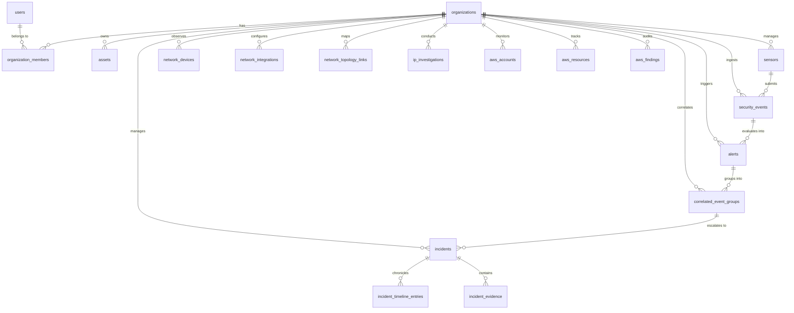

# SENTINEL SOC — Database Architecture & Schema Specification

Sentinel SOC supports both **PostgreSQL 16** (recommended for production multi-tenant deployments) and **SQLite** (for zero-dependency native development and automated testing). The database is managed via SQLAlchemy 2.0 ORM.

---

## 🏛️ Entity-Relationship Diagram

---

## 🗄️ Core Tables & Column Definitions

### 1. Identity & Multi-Tenancy
- **`users`**: Analyst and administrator accounts. Passwords hashed using `bcrypt`.
- **`organizations`**: Multi-tenant boundaries.
- **`organization_members`**: RBAC mapping per tenant (`Platform Administrator`, `Organization Owner`, `Organization Administrator`, `Security Analyst`, `Viewer`).

### 2. Assets & Endpoint Sensors
- **`assets`**: Monitored endpoints (Windows, Linux, network appliances). Tracks `health_status`, `risk_level`, `os_family`, `private_ips`, `public_ip`.
- **`sensors`**: Enrolled agent daemons. Stores `api_key_hash` (SHA-256) and capability flags.
- **`sensor_enrollment_tokens`**: Ephemeral single-use tokens.

### 3. Security Events & Detections
- **`security_events`**: High-throughput telemetry ledger with `is_simulated` partitioning.
- **`detection_rules`**: 13 configurable rules with `threshold`, `time_window_seconds`, and `correlation_pattern`.
- **`alerts`**: High-fidelity detection events.
- **`correlated_event_groups`**: Correlated attack chains (e.g. brute-force followed by C2 beacon).

### 4. Incident Management & Timelines
- **`incidents`**: Incident cases tracking lifecycle (`New`, `Investigating`, `Contained`, `Remediated`, `Closed`).
- **`incident_timeline_entries`**: Chronological case audit trail tracking actions, analyst notes, detections, and containment events with actor attribution.

### 5. Threat Intelligence & Investigation (Release 2)
- **`threat_indicators`**: Normalized indicators across AbuseIPDB, GreyNoise, AlienVault OTX, and Spamhaus with confidence ratings, severity, and attribution.
- **`threat_intel_cache`**: TTL-based cache table (default 24h) preventing redundant external API queries.
- **`threat_provider_status`**: Real-time health, rate limit status, and cached indicator counts per provider.
- **`ip_investigations`**: Case dossiers for investigated IPs with analyst notes and verdicts (`Benign`, `Suspicious`, `Malicious`, `Inconclusive`).

### 6. Network Intelligence & Topology (Release 2)
- **`networks`**: Registered subnets with CIDR ranges.
- **`network_devices`**: Discovered endpoints via ARP caches and DHCP leases. Tracks MAC address, vendor, and discovery method.
- **`network_integrations`**: Gateway adapters for pfSense, OPNsense, UniFi, and OpenWrt.
- **`network_topology_links`**: Graph edges classified strictly as `OBSERVED` (verified via ARP/socket) or `INFERRED` (CIDR co-location).

### 7. AWS Cloud Security (Release 2)
- **`aws_accounts`**: Registered AWS account connections with `sts:AssumeRole` ARN and per-tenant `external_id`.
- **`aws_resources`**: Discovered cloud assets (S3 buckets, IAM users, EC2 instances).
- **`aws_findings`**: Posture findings from Security Hub, GuardDuty, and IAM audits with remediation guidance.

---

## 🔒 Data Isolation & Partitioning Strategy

1. **Mandatory Tenant Scoping:** Every query executed against tenant-bound tables includes `WHERE organization_id = :active_org_id`.
2. **Strict Telemetry Grounding:** `is_simulated = True` is indexed and surfaced across all views and CSV/JSON exports.
