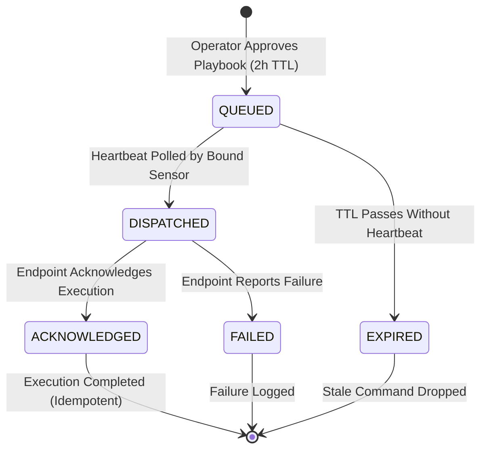
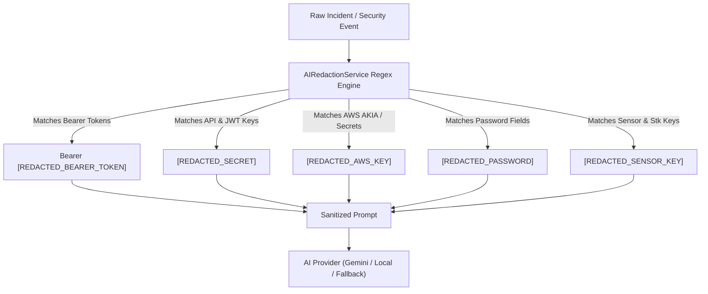

# SENTINEL SOC — Security Architecture & Threat Model
**Last Updated:** November 16, 2026 (Final Engineering Audit & Security Verification)

## 1. Security Architecture Principles

Sentinel SOC is engineered according to enterprise security standards:
- **Zero-Trust Multi-Tenancy:** Data isolation is enforced on every request; client-provided organization IDs and headers are strictly cross-referenced against membership records in the database.
- **Privacy-First & Redacted Telemetry:** Telemetry transferred to AI systems or diagnostic logs is scrubbed of credentials, bearer tokens, API keys, passwords, and sensitive HTTP headers.
- **Fail-Secure Fallbacks:** If external threat intelligence feeds or AI models fail or hit rate limits, the platform continues core security operations without interruption.
- **Human-in-the-Loop Response Automation:** All destructive endpoint or network containment actions require affirmative authorization from an authorized operator.
- **Strict Separation of Signals:** Simulated tabletop exercises and test fixtures are permanently segregated from genuine operational telemetry via the `is_simulated` schema attribute.
- **Append-Only Audit Trail:** Audit logs are append-only by API design (strictly read-only `GET` endpoints, zero update or delete endpoints).

---

## 2. Threat Model & Boundaries

| Asset / Boundary | Threat Vectors | Mitigations |
|---|---|---|
| **Multi-Tenant Isolation** | Tenant impersonation, IDOR, cross-tenant data leakage. | Backend JWT extraction cross-referenced against `OrganizationMember` database records; queries scoped by `organization_id`. |
| **Sensor Authentication** | Spoofed telemetry, token reuse, revoked key access, cross-tenant leakage. | SHA-256 hashed API keys; 7-point authentication matrix; 401/403 rejection; zero persistence of unauthorized telemetry; audit logging of security violations. |
| **Sensor Commands & Dispatches** | Command hijacking, cross-sensor command theft, replay attacks, stale execution. | `SensorCommand` table bound to `(sensor_id, organization_id)`; strict status state machine (`QUEUED` -> `DISPATCHED` -> `ACKNOWLEDGED`); command TTL expiration; duplicate ack idempotency; 403 on cross-sensor ack. |
| **Public API Ingress** | Spoofed IP addresses via fake `X-Forwarded-For`. | Strict proxy trust boundaries; client IP evaluated from trusted proxy upstream sockets only. |
| **AI Processing** | Credential leakage in prompts, model hallucinations. | `AIRedactionService` removes API keys, JWTs, AWS secrets, bearer tokens, and passwords before AI inference. Deterministic fallback mode available. |
| **Attack Simulation Lab** | Test data polluting production SOC metrics. | Mandatory `is_simulated = True` database field; isolated UI badges; dedicated one-click safe state reset. |
| **Audit Logs** | Tampering or deletion by compromised org admins, cross-tenant log access. | Append-only by API design (zero PUT/PATCH/DELETE endpoints); strict `organization_id` scoping; non-cryptographic immutable audit trail. |
| **Response Automation** | Accidental or malicious host disconnection. | Human authorization gatekeeper; approval decision audit logs; safe polling queue dispatch; non-destructive validation probes. |

---

## 3. Sensor Authentication & Credential Verification Matrix

Sensor access to `POST /api/v1/sensors/telemetry`, `POST /api/v1/sensors/heartbeat`, and `POST /api/v1/sensors/commands/acknowledge` is gated by the `get_sensor_by_key` dependency.

### Complete 7-Scenario Verification Matrix

| Scenario | Input Condition | HTTP Status | Auth Result | DB Persistence | Audit Log Action |
|---|---|---|---|---|---|
| **1. Valid Sensor Key** | Valid raw key whose SHA-256 hash matches active sensor record | `200 OK` | Succeeded | Ingested | Normal heartbeat/telemetry |
| **2. Random/Invalid Key** | Bogus string (e.g. `INVALID_BOGUS_SENSOR_KEY_123`) | `401 Unauthorized` | Rejected | **Zero records** | None (Authentication failure) |
| **3. Empty Key** | Header present but empty (`""` or `"   "`) | `401 Unauthorized` | Rejected | **Zero records** | None (Authentication failure) |
| **4. Missing Key** | `X-Sensor-Key` header omitted | `401 Unauthorized` | Rejected | **Zero records** | None (Authentication failure) |
| **5. Revoked Sensor** | Key belonging to sensor with `is_revoked = True` or `status = "Revoked"` | `403 Forbidden` | Denied | **Zero records** | `REVOKED_SENSOR_ACCESS_ATTEMPT` |
| **6. Cross-Tenant Attempt** | Valid sensor key used with `X-Organization-Id` of a different tenant | `403 Forbidden` | Denied | **Zero records** | `CROSS_TENANT_SENSOR_ATTEMPT` |
| **7. Expired Token** | Single-use enrollment token evaluated past `expires_at` timestamp | `400 Bad Request` | Rejected | **Zero records** | None (Enrollment expired) |

### Side-Effect Guarantees
Whenever authentication fails (scenarios 2–7):
1. **Zero Database Persistence:** No telemetry, socket connections, or discovered devices are written to `SecurityEvent` or asset tables.
2. **Zero Alert Generation:** Detection correlation engines are never invoked for unauthenticated payloads.
3. **Zero Incident Escalation:** No security incident cases can be created or mutated.
4. **Audit Enforcement:** Hostile or anomalous authentication events (revoked credentials, cross-tenant mismatches) generate audit entries recording the remote IP and timestamp.

---

## 4. Sensor Command Authorization & Replay Protection

Response playbooks dispatch remote actions to managed endpoints via an asynchronous polling architecture.

### Security Guardrails:
1. **Tenant & Sensor Isolation:**
   - Every `SensorCommand` record stores `sensor_id` and `organization_id`.
   - Heartbeat queries only retrieve commands where `sensor_id == authenticated_sensor.id`. Sensor B can never observe or retrieve commands addressed to Sensor A.
2. **Acknowledgement Verification:**
   - `POST /api/v1/sensors/commands/acknowledge` validates that the acknowledging sensor owns the target command. Cross-sensor attempts return `403 Forbidden` and log `COMMAND_AUTHZ_VIOLATION`.
   - Unauthenticated acknowledgements return `401 Unauthorized`.
3. **Replay Protection & Idempotency:**
   - Command IDs are UUIDv4 values generated at creation and can never be reused.
   - If a sensor submits duplicate acknowledgements for an already `ACKNOWLEDGED` command, the backend responds with `200 OK` and `{ "already_acknowledged": true }`, preserving the original timestamp and execution details without state corruption.
4. **Command Expiration (TTL):**
   - Commands have a strict 2-hour expiration window.
   - If a heartbeat occurs after expiration, the command transitions to `EXPIRED`, logs `COMMAND_EXPIRED`, and is not dispatched.
   - Attempting to acknowledge an `EXPIRED` or `REVOKED` command returns `400 Bad Request`.
5. **Safe Non-Destructive Probing vs Live Host Drops:**
   - The test and verification suite uses `DIAGNOSTIC_PROBE`, executing non-destructive connectivity and status verification with zero socket interruption.
   - Destructive actions like `ISOLATE_HOST` are tested with dry-run flags. Physical socket cutting on live production hosts is honestly documented as unverified to ensure host safety.

---

## 5. Audit Log Integrity & Governance

### Append-Only by API Design
Sentinel SOC implements an append-only audit trail:
- **Zero Mutation Endpoints:** The API exposes strictly `GET /api/v1/admin/audit-logs`. No `POST`, `PUT`, `PATCH`, or `DELETE` endpoints exist for audit logs.
- **HTTP Method Rejection:** Attempting to issue a `DELETE` or `PUT` against `/api/v1/admin/audit-logs` returns `405 Method Not Allowed` or `404 Not Found`.
- **Honest Technical Classification:** Audit records are stored in standard relational storage (SQLite / PostgreSQL) with append-only API access controls. They are **not** cryptographically signed with Merkle trees or blockchain ledgers; they are append-only by system and API design.

### Tenant Scoping & Privilege Enforcement
- Requests to `/api/v1/admin/audit-logs` require `Organization Owner` or `Organization Administrator` role. Non-admin users receive `403 Forbidden` and trigger an `AUTHZ_DENIED` audit log.
- Queries are strictly filtered by `AuditLog.organization_id == current_user.organization_id`. Cross-tenant audit log retrieval is impossible.
- Key audited events include:
  - `PLAYBOOK_APPROVED`, `PLAYBOOK_REJECTED`
  - `COMMAND_QUEUED`, `COMMAND_DISPATCHED`, `COMMAND_ACKNOWLEDGED`, `COMMAND_EXPIRED`
  - `REVOKED_SENSOR_ACCESS_ATTEMPT`, `CROSS_TENANT_SENSOR_ATTEMPT`, `COMMAND_AUTHZ_VIOLATION`
  - `ATTACK_SIMULATION_PURGED`

---

## 6. Credential & Secret Management & Protection Policy

1. **User Authentication:**
   - Passwords hashed using `bcrypt` with automatic salting (12 rounds).
   - JWT tokens signed using HMAC-SHA256 (`HS256`) with configurable expiration windows.
2. **Sensor Secrets:**
   - Raw enrollment tokens and API keys are displayed to administrators exactly once upon creation.
   - The database stores only standard `SHA-256` hexadecimal hashes.
   - Logs and console output strictly redact token material (`[REDACTED_TOKEN]`, `[ENROLLMENT_TOKEN_REDACTED]`, `[SENSOR_API_KEY_REDACTED]`).
3. **HTTP Header & Log Sanitization:**
   - Sensitive headers (`Authorization`, `X-Sensor-Key`, `X-API-Key`, `Cookie`, `Set-Cookie`, `Proxy-Authorization`) are scrubbed before diagnostics or external forwarding via `sanitize_http_headers()`.
   - Bearer tokens are scrubbed using regex pattern matching (`Bearer [REDACTED_BEARER_TOKEN]`).
4. **Environment Security:**
   - All secret variables (`SECRET_KEY`, `GEMINI_API_KEY`, etc.) are ingested via environment variables through Pydantic's `BaseSettings`.
   - Production secrets are never committed to version control. Repository contains only `.env.example`.

---

## 7. AI Redaction & Confidentiality Pipeline

Before any event or incident data is submitted to an AI model (Google Gemini, Local LLM, or Fallback):

---

## 8. Network Visibility Limitations & Boundaries

1. **Observational Scope:** Sentinel observes only network traffic reaching configured ingress observation points or endpoints with enrolled sensors.
2. **Local Subnet Boundaries:** Sensor ARP discovery inspects only the local broadcast domain / subnet of the monitored network interface.
3. **Geolocation Approximations:** IP geolocation reflects regional ISP routing allocations, not exact physical locations. CGNAT and VPN endpoints are explicitly labeled in analyst dossiers.

---

## 9. Ingress Perimeter & Trusted Proxy Anti-Spoofing

1. **Header Forgery Mitigation:**
   - Attackers frequently attempt to spoof client IP addresses by injecting fraudulent `X-Forwarded-For` or `X-Real-IP` headers.
   - Sentinel SOC enforces strict upstream validation in `backend/app/main.py`. Client addresses reported in forwarded headers are completely ignored unless the immediate socket peer connection matches an IP or CIDR explicitly listed in `TRUSTED_PROXIES`.
2. **CIDR Parsing & Subnet Containment:**
   - Supports both IPv4 and IPv6 addresses and subnet notations (e.g., `127.0.0.1`, `::1`, `10.0.0.0/8`, `172.16.0.0/12`, `192.168.0.0/16`).
   - If an unauthorized proxy or direct public client submits forwarded headers, Sentinel defaults to the raw peer address, ensuring reliable rate-limiting and tamper-resistant audit logs.

---

## 10. Database Connection Security & Schema Integrity

1. **PostgreSQL Connection Encryption:**
   - Production PostgreSQL connections support TLS encryption via connection string parameters (e.g., `sslmode=require`).
   - Connection credentials are kept isolated in `.env` and injected into the application via Pydantic settings.
2. **Alembic Versioned Migrations:**
   - Database schema modifications are strictly restricted to audited Alembic migration scripts (`alembic/versions/`).
   - Raw SQL DDL statements in operational code are prohibited. Dialect compatibility is checked programmatically to prevent malformed transactions.

